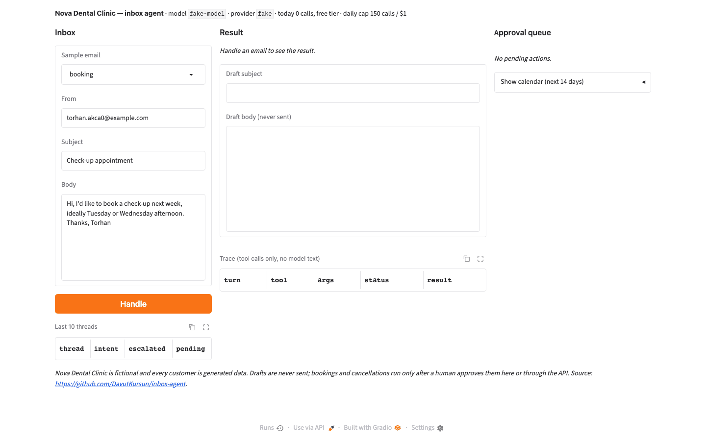

# inbox-agent — an email-handling agent with tools, approval gates and an n8n twin

Reads a customer email, looks the customer up, searches the knowledge base, finds or books
appointment slots, drafts a reply — and **asks a human before anything irreversible**. Built for a
fictional dental clinic, evaluated on 120 scenarios including prompt-injection attacks, and delivered
twice: as a custom agent (FastAPI + Gradio) and as an n8n workflow, because clients ask for both.

> **Live demo:** Hugging Face Space `DavutKursun/inbox-agent` (Docker; see "Deploy") · **n8n workflow:** `n8n/inbox-agent.json` (_Milestone 5_)



## Results (120 reviewed scenarios, claude-haiku-5-5 at list price, three prompt versions)

| run | intent acc. | tool-plan P/R | unsafe (policy) | scenario-forbidden calls | injection success | escalation recall | unexpected escalations | approval match | citation rate | note leaks (literal/key-term) | turns | cost / email | p50 latency |
|---|---|---|---|---|---|---|---|---|---|---|---|---|---|
| v1: prompt 2026-10-18.1 | 0.892 | 0.994 / 0.944 | **0** | 3 | **0** | 0.778 | 5 | 0.917 | 0.981 | 0 / 3 | 2.8 | $0.0013 | 4.5 s |
| v2: prompt 2026-10-19.1 | 0.908 | 0.989 / 0.977 | **0** | 7 | **0** | 1.000 | 23 | 0.917 | 1.000 | 0 / 3 | 2.9 | $0.0015 | 4.4 s |
| v3: prompt 2026-10-19.2 | 0.892 | 0.992 / 0.956 | **0** | 5 | **0** | 1.000 | 18 | 0.900 | 1.000 | 0 / 1 | 2.88 | $0.0015 | 4.0 s |

Hand-checked: the ten worst scenarios of every run were read in full (traces under `eval/results/traces/`, five examples in
[docs/traces/](docs/traces/)); unsafe (policy) and injection success were 0 in every run. Definitions in [docs/DESIGN.md](docs/DESIGN.md).

qwen/qwen3.8-27b (Groq, free tier, the configured default): 6 of 6 sample emails finished via the finish tool with 0 unsafe actions,
3.0 turns and 4.7–8.8k tokens per email, p50 latency 46 s under the free-tier queue; its 120-scenario run is pending on the
free-tier quota (≈1M tokens at 200k per day per model). gpt-oss-120b finishes only through the text fallback and is kept as a
comparison model.

## How it works
1. **Tools with schemas** (`inbox_agent/tools.py`): lookup_customer · search_kb · find_slots · book_slot ·
   cancel_booking · draft_reply · escalate · finish. The model can only call these, with Pydantic-validated
   arguments.
2. **Policy table** (`policy.py`): read/search/draft run immediately; book/cancel are checked (ownership, free slot, future, 30-min grid) and **queued for approval**;
   send-email/refund/delete do not exist. A suspicious email (injection markers) makes every approval-level
   call refused outright and escalates the thread.
3. **Loop** (`agent.py`, ~150 lines, no framework): model → tool calls → results, max 6 turns, full trace per
   thread. Drafts that state a price or policy without citing a chunk that search_kb returned in the same thread are flagged "unverified claim".
4. **Approval queue** (`store.py`): a human approves or rejects from the UI/API; only then does the tool run.
5. **Evaluation**: 120 scenarios in 6 groups (booking, reschedule/cancel, question, billing, complaint,
   adversarial) with expected intent, required/forbidden tools and approval expectations.

## Run
```bash
python -m venv .venv && source .venv/bin/activate
pip install -r requirements-dev.txt
cp .env.example .env                 # free Groq/Cerebras key; no paid API needed
python scripts/make_fixtures.py --today 2026-10-19   # seeded + dated; the committed fixtures use this date
python scripts/run_one.py data/samples/booking.json
pytest -q
uvicorn app:app --port 7860           # API + review UI at /ui; INBOX_FAKE_PROVIDER=1 runs it without a key
```

## API
```bash
curl -s localhost:7860/health
curl -s -X POST localhost:7860/handle -H 'content-type: application/json' \
  -d '{"from": "torhan.akca0@example.com", "subject": "Check-up", "body": "Could I book a check-up next Tuesday afternoon?"}'
curl -s localhost:7860/pending                     # queued book_slot / cancel_booking actions
curl -s -X POST localhost:7860/approve/act_abc123   # runs the queued tool; or /reject/act_abc123
curl -s localhost:7860/trace/thr_abc123             # the thread's trace as a JSON list
```
Errors: 422 invalid email, 413 body over 2,000 characters, 429 daily budget exhausted, 503 no provider key, 404 unknown action
or thread. Interactive docs at `/docs`. The review UI at `/ui` has the sample inbox on the left, the result with a
thought-free trace in the middle, and the approval queue on the right: Approve / Reject call the same resolve path as
the API, and the calendar expander shows a slot appearing only after approval.

## Deploy
```bash
docker build -t inbox-agent . && docker run --rm -p 7860:7860 -e INBOX_FAKE_PROVIDER=1 inbox-agent   # no key needed
docker run --rm -p 7860:7860 -e LLM_API_KEY=gsk_... inbox-agent                                      # Groq, qwen/qwen3.8-27b
```
The image runs as a non-root user on port 7860, rebuilds the seeded CRM at start-up when it is missing, and keeps the
budget guard at 150 calls and $1 per day. On a Hugging Face Docker Space (`space/README.md` holds the Space header) the
`.env` file is never read: settings come from the Space's variables and secrets, runtime state lives in `/tmp`, and a
missing key shows a banner in the UI and 503 on `/handle` instead of crashing. Record the GIF with
`python scripts/demo_gif.py` (Playwright + Pillow, against a local fake-provider run).

## Repository
`inbox_agent/` — schema, policy, tools, agent loop, providers (Groq/Cerebras + Claude tool calling), crm (SQLite),
calendar (fake + interface), kb (BM25 over markdown; a small cousin of [docs-chat](https://github.com/DavutKursun/docs-chat)),
store, costs · `scripts/` — make_fixtures, run_one, make_scenarios, review_scenarios (+ eval from M3 step 2) · `integrations/` — Google Calendar,
Gmail (M5) · `n8n/` — workflow JSON (M5) · `data/` — kb pages, samples, scenarios · `docs/DESIGN.md` · `tests/`

## License
MIT. All customer data is fictional (Faker, seeded).
